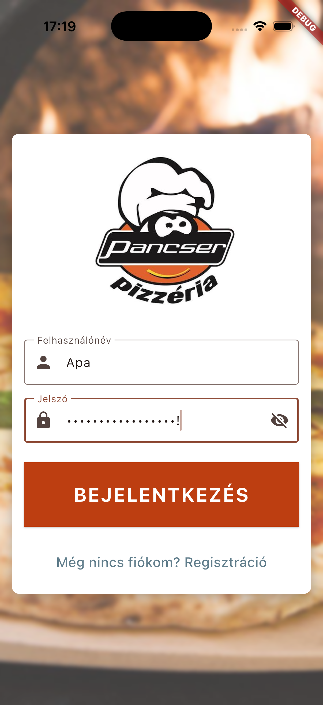
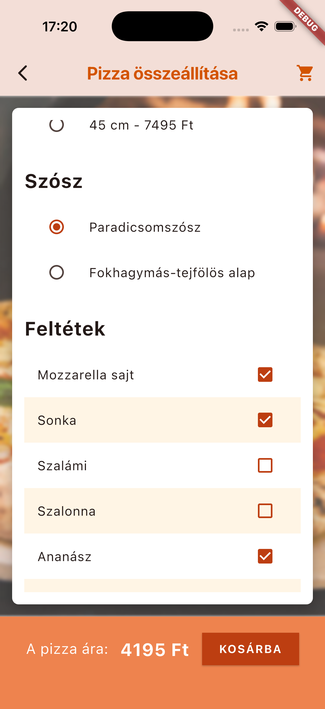
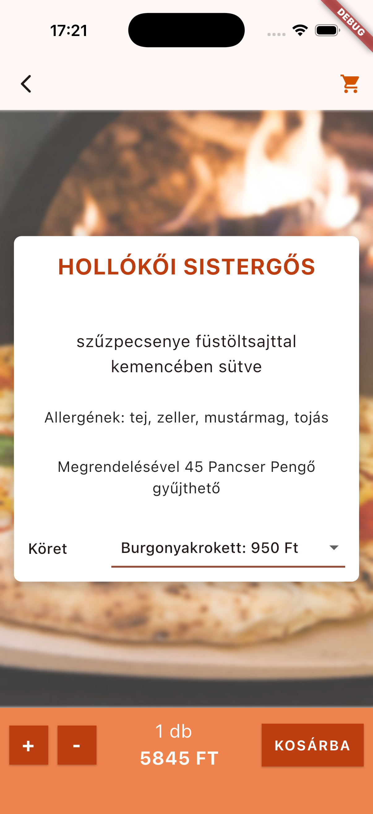
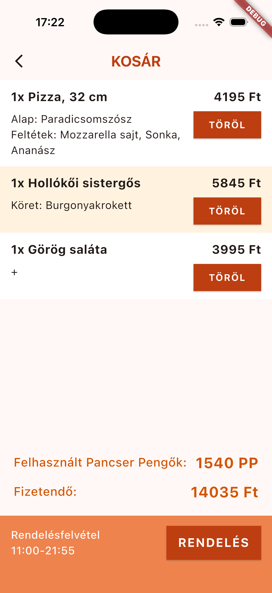
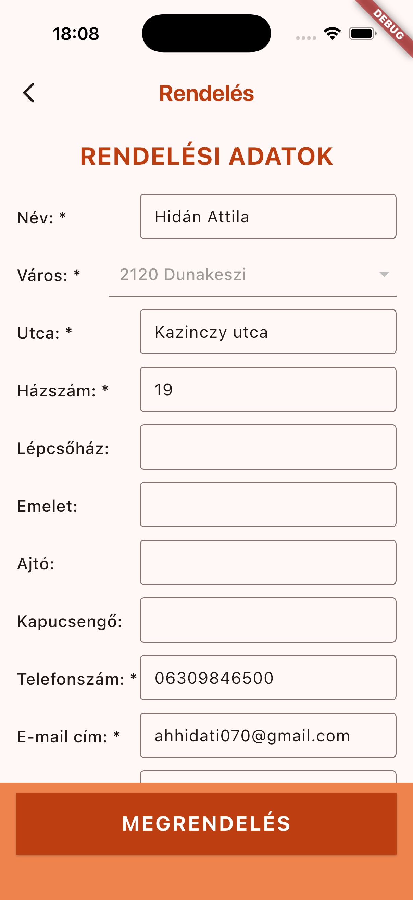

# nem_pancser

The remake of the application of a pizzeria. 
Logged-in users can browse the menu, choose dishes, build pizzas and order, and get rewards. I plan to feature delivery tracking in the future. 
Uses Flutter for frontend, NestJS for backend, JWT for authentication and MongoDB database. 

